<div align="center">

# Strategy Fantasy

**Rundenstrategie mit Herz, Humor und Pixel-Art**


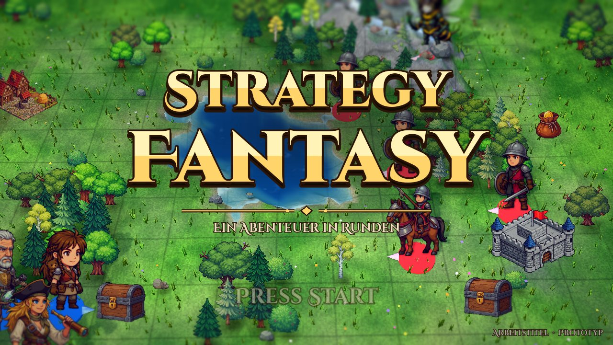

*Ein Mädchen, ein Bär und ein Regent, der Steuern rückwirkend eintreibt.*

**[Testversion herunterladen (macOS und Windows)](https://github.com/joergsf4/Fantasy_Strategy/releases)**

</div>

---

Rundenstrategie im Stil von **Fire Emblem** und **Advance Wars**, gebaut mit **Godot 4**: 3D-Karten mit rechteckigem Raster, Pixel-Art-Figuren, Anime-Dialoge, Spezialfähigkeiten als Werkzeuge in den Missionen und eine Geschichte voller schräger Figuren. Ein Spaßprojekt, nicht kommerziell.

## Was dich erwartet

<table>
<tr>
<td width="50%">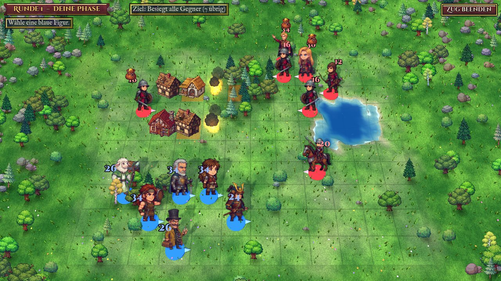<br><b>Taktik auf lebendiger Karte.</b> Gelände, Deckung, Flanken- und Rückenangriffe, Warten und Verteidigen. Und ein Dorf, das du vor dem Feuer retten sollst.</td>
<td width="50%">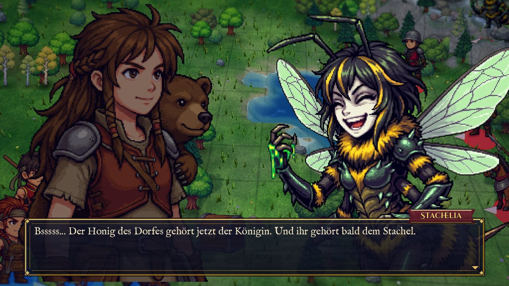<br><b>Anime-Dialoge mit Witz.</b> Figuren links und rechts, Tilt-Shift-Karte dahinter, und beim Tippen brabbelt jede Figur auf ihre Weise.</td>
</tr>
<tr>
<td width="50%">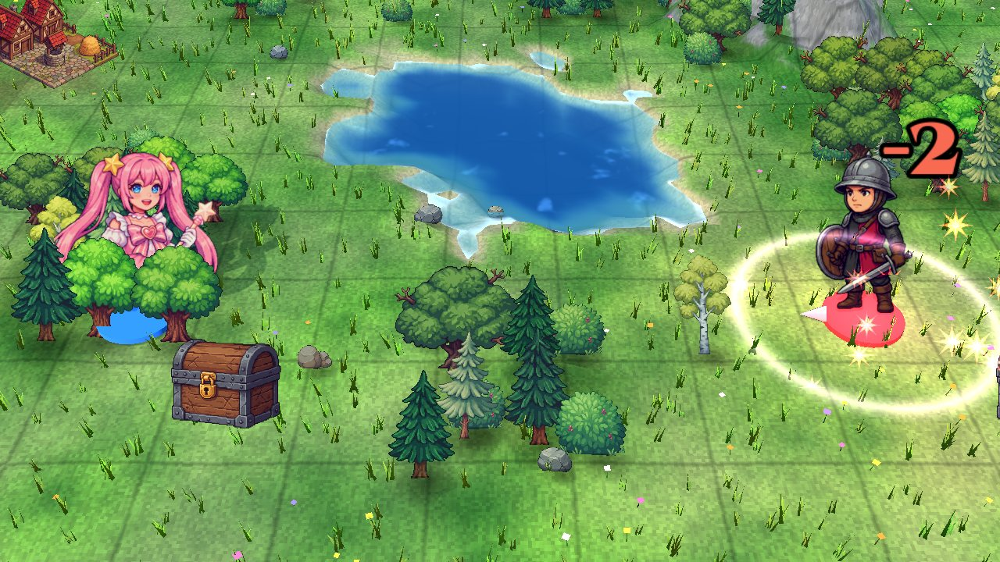<br><b>Spezialfähigkeiten mit Auftritt.</b> Jede Fähigkeit hat eine eigene Animation, eigene Effekte und eigenen Sound.</td>
<td width="50%">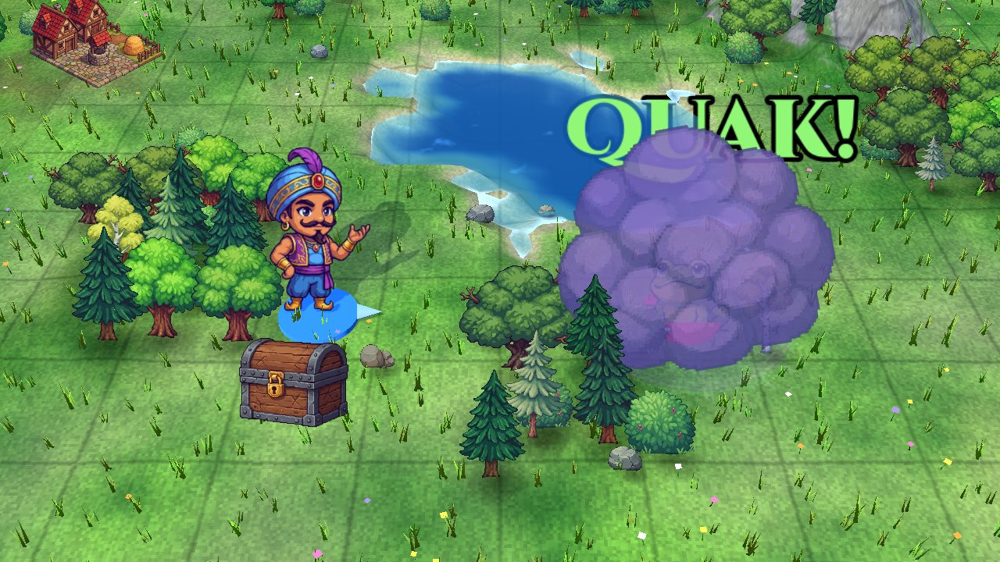<br><b>Mit Humor.</b> Fässer, Frösche, Gebisse, Bärenumarmungen und ein Hund, der ganze Armeen anbellt.</td>
</tr>
<tr>
<td width="50%">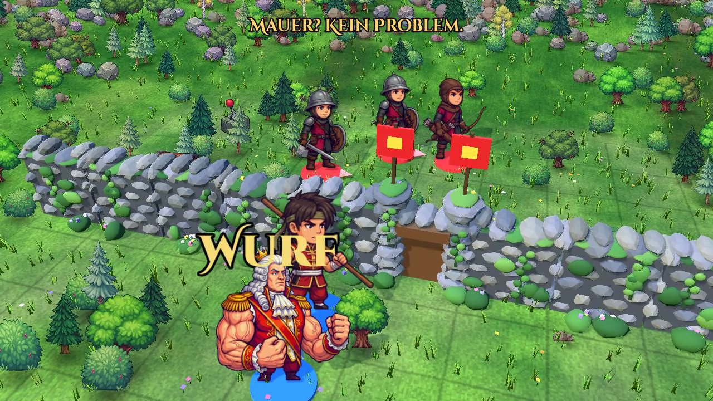<br><b>Rätsel im Gelände.</b> Mauern, Tore, Schalter, Feuer, Geiseln und Glocken: Fähigkeiten lösen sie. Hier wirft Muskelaugust einen Freund über die Mauer.</td>
<td width="50%">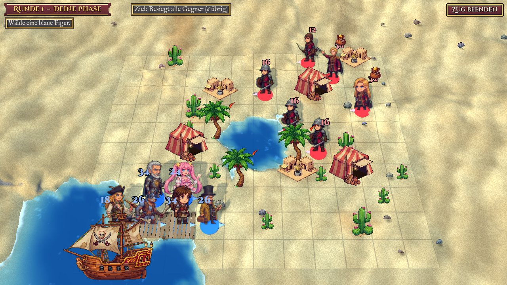<br><b>Verschiedene Welten.</b> Dörfer, ein Teehaus am Pass, ein Hafen mit Piratenschiff und ein Sandhafen in der Wüste.</td>
</tr>
</table>

### Geheime Interaktionen und Super-Attacken

Manche Fähigkeiten wirken auf Verbündete anders, als man denkt. Wer es herausfindet, wird mit einer eigenen Szene und einer **Super-Attacke** belohnt: Polarlicht-Himmel, der stark vergrößerte Held und eigene Musik. Hier ein Blick auf das erste Geheimnis (Spoiler!). Es gibt Raum für mehr.

<table>
<tr>
<td width="50%">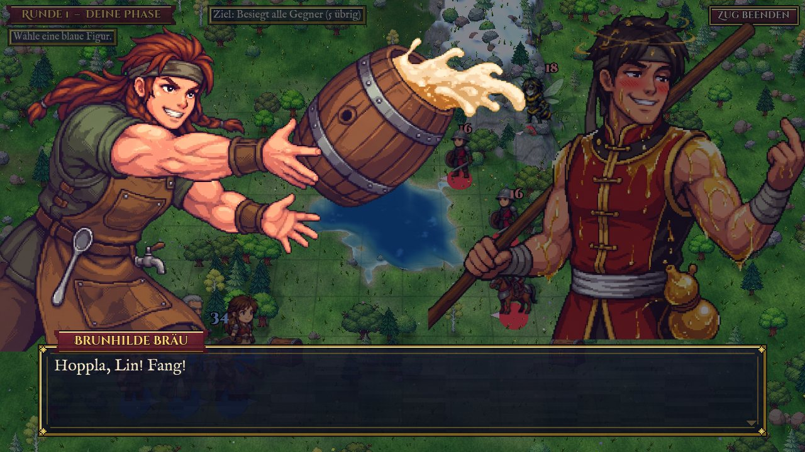<br>Die Szene vor der Karte, mit Tiefenwirkung und fliegendem Fass.</td>
<td width="50%">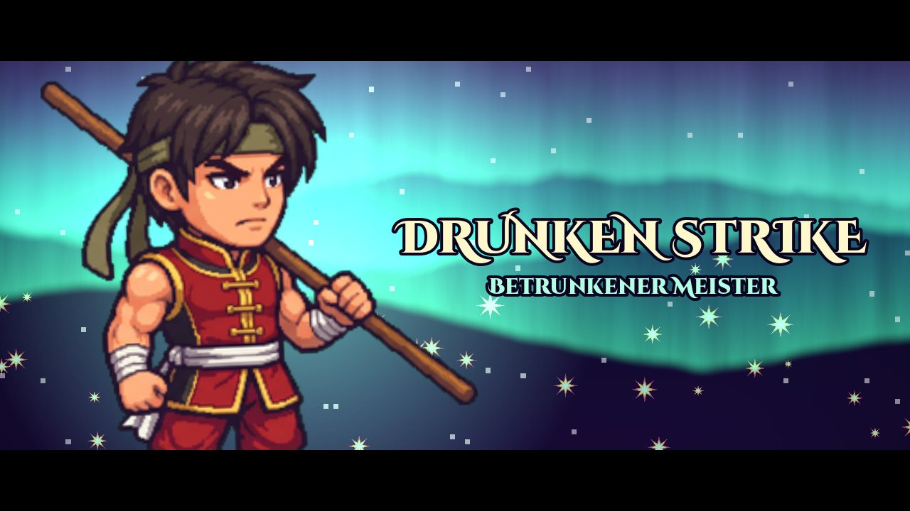<br>Der Auftritt der Super-Attacke.</td>
</tr>
</table>

### Lager, Gruppenwahl und Statistik

<table>
<tr>
<td width="33%">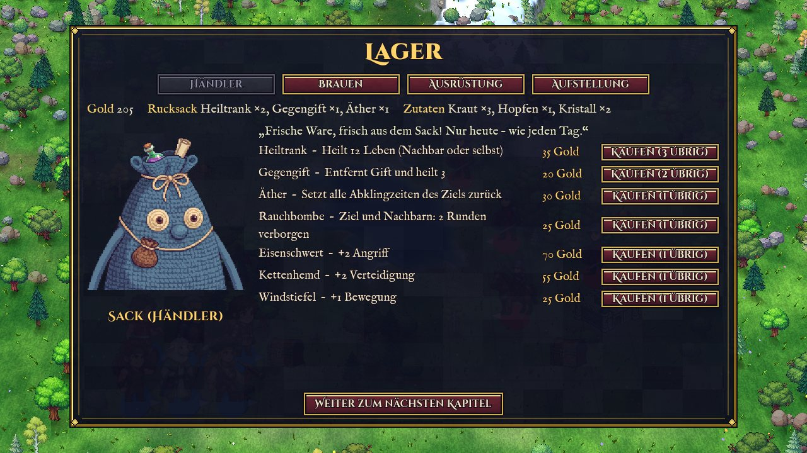<br><b>Lager.</b> Händler Sack (ein lebender Wollsack), Brauen, Ausrüstung und Aufstellung.</td>
<td width="33%">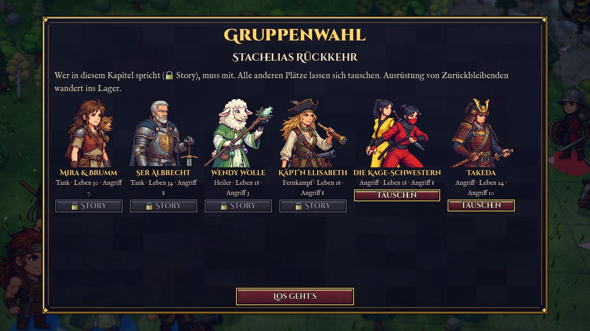<br><b>Gruppenwahl.</b> Vor jeder Runde wählst du deine Helden. Wer in der Geschichte gebraucht wird, ist gesperrt.</td>
<td width="33%">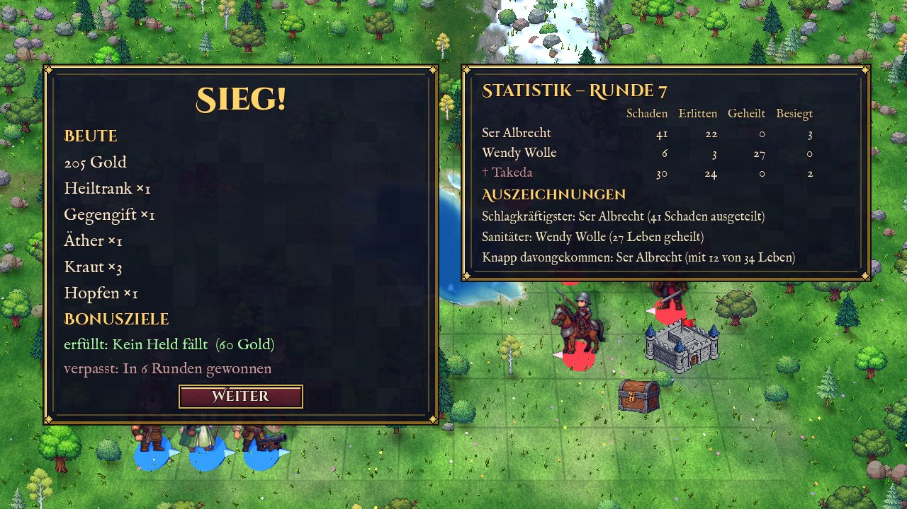<br><b>Statistik.</b> Beute, Bonusziele und Auszeichnungen, nach dem Sieg mit fröhlicher, nach der Niederlage mit trauriger Musik.</td>
</tr>
</table>

## Besonderheiten

- **Benannte Gegner sterben nicht**, sondern fliehen wütend und tauchen in späteren Missionen wieder auf, mit eigenen Dialogen.
- **Fähigkeiten als Werkzeuge:** Stabsprung über Gräben, Kanone gegen Mauern, Fässer gegen Feuer, Glocken, die Verstärkung rufen, und vieles mehr.
- **Gemeinsame Abklingzeit** je Figur: Man hat die Wahl, nicht mehr Spezialeffekte pro Runde.
- **Gruppenwahl mit Story-Sperre:** Nur wer im Kapitel spricht, muss mit, der Rest ist frei wählbar.
- **Brabbel-Laute** beim Dialogtext (Robo piept, Wendy blökt, der Hundsfreund bellt …) statt Sprachausgabe.
- **Alles datengetrieben:** Einheiten, Fähigkeiten, Missionen, Karten, Dialoge und Geheimnisse liegen als JSON in `game/data/` und lassen sich mit dem Dialog-Editor bearbeiten.

## Spielen

### Fertige Testversion
Unter [Releases](https://github.com/joergsf4/Fantasy_Strategy/releases) liegen ZIPs für macOS und Windows.
- **macOS:** ZIP entpacken, Rechtsklick auf die App, „Öffnen“ (nicht notarisiert). Falls macOS sie sperrt: `xattr -cr "Strategy Adventure.app"`.
- **Windows:** ZIP entpacken, `StrategyAdventure.exe` starten. SmartScreen warnt eventuell („Weitere Informationen“, „Trotzdem ausführen“). Die Windows-Version wurde noch nicht getestet.

### Aus dem Quelltext
```
godot --path game
```
Benötigt Godot 4.7 (Compatibility-Renderer).

### Steuerung
- **Start im Vollbild.** F11 oder das Pause-Menü schalten zwischen Vollbild und Fenster um.
- **Maus:** Figur wählen, Feld wählen, Menü neben der Figur. Rechtsklick geht zurück.
- **Dialoge:** Linksklick, Enter oder Leertaste schaltet weiter.
- **Alt (gedrückt halten):** zeigt über allen Figuren Lebenszahl und alle Status mit Restdauer. Sonst steht über jeder Figur nur ein schmaler Lebensbalken, Details zeigen Auswahl und Hover.
- **Esc:** öffnet das Pause-Menü (Weiter, Speichern, Vollbild, Beenden). Beim Beenden bleibt der Stand nach der letzten geschafften Mission erhalten.
- **Hauptmenü:** *Fortfahren* (nur mit Spielstand, geht im Lager vor dem nächsten Kapitel weiter), *Neues Spiel* (mit Rückfrage, löscht den Spielstand) und *Beenden*. Bedienung mit Maus oder Pfeiltasten und Enter.
- **Speichern:** automatisch nach jeder geschafften Mission (Meldung „Spielstand automatisch gespeichert“), zusätzlich von Hand im Pause-Menü.
- **Testmenü:** Im Hauptmenü kleingeschrieben `brumm` tippen („Kapitelwahl freigeschaltet“), dann gibt es nach dem Start die Kapitelwahl (mit oder ohne Einleitung), das Soundlabor und „Spielstand zurücksetzen“.

## Werkzeuge

### Dialog-Editor
```
python3 tools/dialog_editor/server.py     # dann http://127.0.0.1:8765 im Browser öffnen
```
Weboberfläche für Gespräche und Spieldaten, nur mit der Python-Standardbibliothek. Ein gemeinsamer Speichern-Button (Strg+S) mit Änderungsanzeige gilt in allen Tabs.

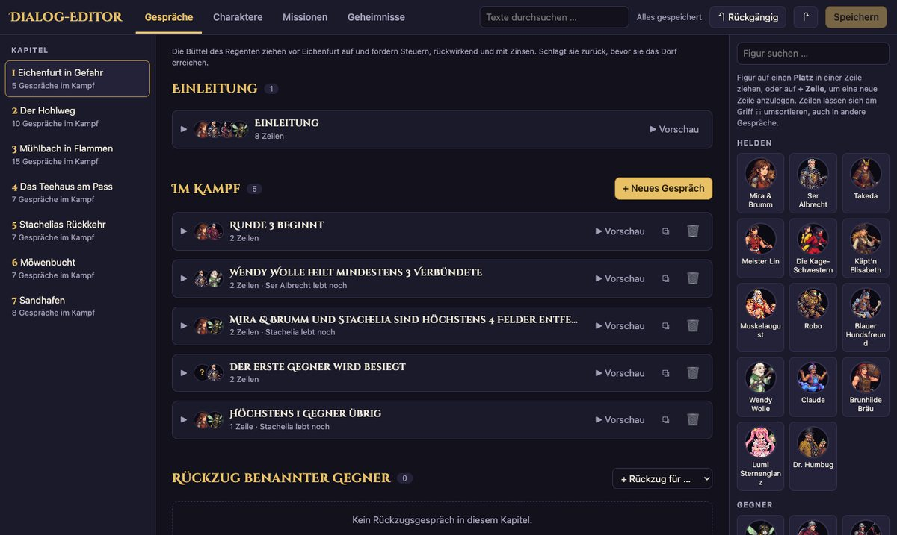

- **Gespräche:** Einleitung, Abschluss, Gespräche im Kampf mit Auslösern und Rückzug benannter Gegner. Texte bearbeiten, Figuren per Drag-and-Drop zuordnen, Zeilen umsortieren, Vorschau wie im Spiel, neue Gespräche aus einer Beschreibung entwerfen (braucht die Claude-CLI).
- **Charaktere:** Übersicht aller Figuren (erstes Auftreten, Spezialfähigkeit, Missionen mit Dialogzeilen, Werte, Notizen aus `docs/figuren.md`, Material-Check) als Karten oder Tabelle, dazu zwei Freitextfelder für Fähigkeits-Ideen.
- **Missionen:** Gruppe und Gegner jedes Kapitels per Drag-and-Drop ändern, mit Minikarte und **Story-Warnungen** (z. B. Figur kommt vor ihrer Einführung vor).
- **Geheimnisse:** Ideen für geheime Interaktionen als Freitext-Prompt mit Auswahl der beteiligten Figuren; die technische Umsetzung (Auslöser, Wirkung, Szene) ist optional. Siehe [docs/geheimnisse.md](docs/geheimnisse.md).

<table>
<tr>
<td width="50%">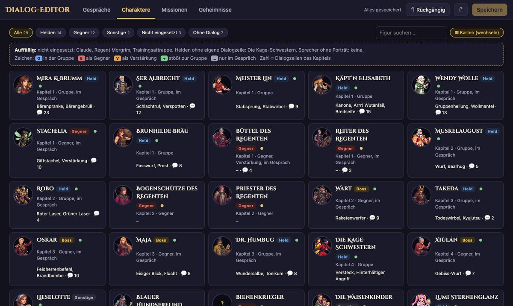</td>
<td width="50%">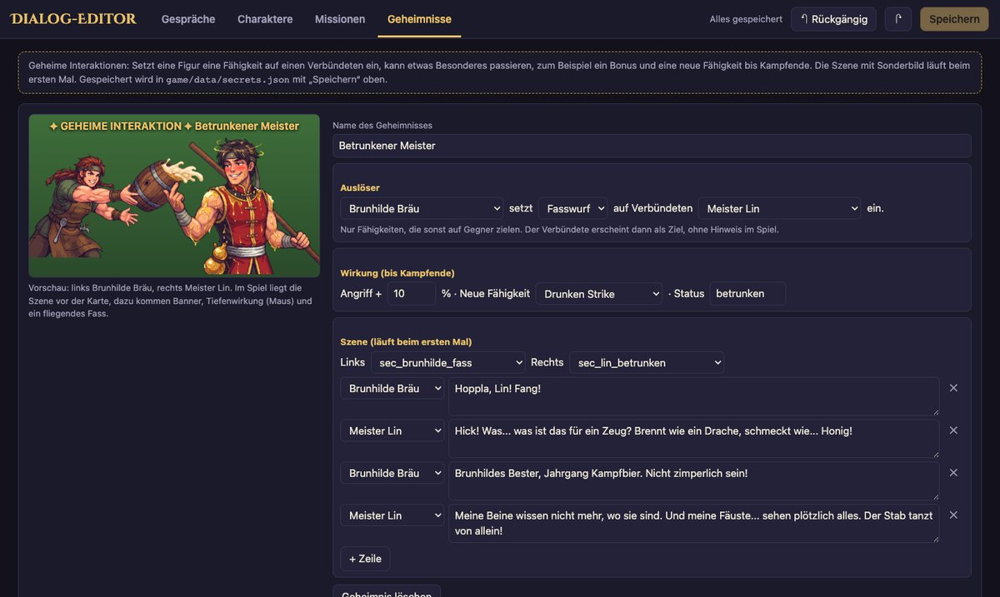</td>
</tr>
</table>

Test: `python3 -m unittest tools/dialog_editor/test_server.py`

### Weitere Werkzeuge in `tools/`
- `chroma_key.py`: Freistellen der Bilder (Greenscreen) für Porträts, Figuren, Effekte
- `gemini/`: Gemini-Automatisierung für Bilder (`run.mjs`) und Musik (`music.mjs`)
- `make_sfx.py`: erzeugt alle Soundeffekte und Brabbel-Laute synthetisch
- `balance.py` mit dem grafikfreien Simulator in `game/sim/`: Balancing-Experimente, Bericht in [docs/balance.md](docs/balance.md)
- `make_trailer.sh`: nimmt Trailer direkt aus dem Spiel auf
- `make_ui.py`, `make_thumbnail.py`: UI-Texturen und Thumbnail

## Projektstruktur
- `game/` Godot-Projekt (Skripte, Daten als JSON, Shader, Assets)
- `docs/` Kampfsystem, Figuren, Missionen, Geheimnisse, Sound, Balancing-Bericht, Backlog
- `tools/` Hilfswerkzeuge (siehe oben)
- `strategie/` Original-Bilder und Musik (Gemini) auf Greenscreen

## Tests
```
godot --headless --path game --script tests/test_combat.gd
```
Dazu viele weitere in `game/tests/` (Fähigkeiten, Missionen, Feuer, Gruppenwahl, Brabbel-Laute, Statistik, Editor-Bedienung und mehr). Jedes Skript läuft einzeln und meldet Fehler als `FAIL`.

## Dokumentation
- [Kampfsystem](docs/kampfsystem.md) · [Figuren](docs/figuren.md) · [Missionen](docs/missionen.md)
- [Geheime Interaktionen und Super-Attacken](docs/geheimnisse.md) · [Sound](docs/sound.md)
- [Balancing](docs/balance.md) · [Backlog](docs/backlog.md)

## Hinweise
- **KI-generierte Inhalte:** Alle Figuren-, Effekt- und Hintergrundbilder (`strategie/`, `game/assets/portraits|tokens|fx`) und die Musik (`game/assets/audio/`) wurden mit Google Gemini erzeugt, die Soundeffekte synthetisch. Programmcode und Daten entstanden mit Claude Code. Das Projekt ist ein nicht kommerzielles Hobbyprojekt.
- **Stand:** Testversion. Werte und Balancing sind vorläufig, Fehler bitte als Issue melden.
- **Schriften:** Cinzel Decorative und IM Fell English (SIL Open Font License, Lizenztexte im Ordner `game/assets/fonts/`).
